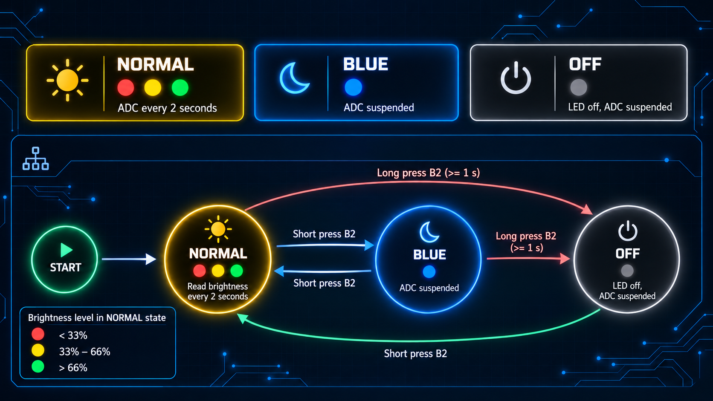

# LED Exercise

**University project**

**Contributors:** Mostafa Abd Al Kader & Cristian Dorhoi Munteanu



A Zephyr RTOS brightness-monitoring and RGB-control application for the
**NUCLEO-WL55JC**. It uses an external common-anode RGB LED, the onboard B2
button, and an LDR voltage divider connected to A0. This circuit produces a
lower ADC voltage under brighter light, so the brightness calculation is
inverted while the terminal continues to show the unmodified raw ADC value.

## Operation

| Mode | RGB behavior | ADC behavior |
| --- | --- | --- |
| NORMAL | Red, yellow, or green according to the ADC percentage | Sample immediately, then every 2 seconds |
| BLUE | Steady blue | Suspended |
| OFF | All channels off | Suspended; Zephyr may enter a STOP state |

Button transitions:

- A short B2 press switches NORMAL ↔ BLUE.
- Holding B2 for at least one second enters OFF immediately from NORMAL or BLUE.
- Releasing B2 after a long press does not generate a short press.
- A short press in OFF restores NORMAL.

## Wiring

The RGB LED is **common anode**. Connect its common pin to 3.3 V and connect
each cathode to its GPIO through a separate current-limiting resistor.

| Signal | Board connection | MCU pin |
| --- | --- | --- |
| RGB common anode | 3V3, CN6 pin 4 | 3.3 V |
| Red cathode | D4, CN9 pin 5 | PB5 |
| Green cathode | D5, CN9 pin 6 | PB8 |
| Blue cathode | D6, CN9 pin 7 | PB10 |
| Analogue signal | A0, CN8 pin 1 | PB1 / ADC1_IN5 |
| Analogue ground | GND, CN6 pin 6 or 7 | GND |
| User input | Onboard B2 | PA1 / `sw1` |

The RGB outputs are active-low:

- GPIO LOW: channel on
- GPIO HIGH: channel off

Keep A0 between 0 V and 3.3 V. Never connect 5 V to A0. An unconnected A0
floats and produces meaningless readings.

## ADC calculation

The ADC is configured for 12-bit conversion, so its complete code range is
0–4095:

```text
full_scale = (1 << 12) - 1 = 4095
brightness_code = 4095 - raw_adc
percentage = brightness_code * 100 / 4095
```

| Brightness | Raw ADC range for this LDR circuit | RGB command |
| --- | --- | --- |
| Below 33% | 2744–4095 | RED |
| 33% through 66% | 1393–2743 | YELLOW (red + green) |
| Above 66% | 0–1392 | GREEN |

## Software architecture

Exactly three application `.c` files are used:

| File / thread | Priority | Responsibility |
| --- | ---: | --- |
| `src/main.c` / main | 4 | Initialization, B2 interrupt and timer, mode FSM, terminal messages |
| `src/Event_Management.c` / RGB | 5 | Exclusive control of the three active-low RGB outputs |
| `src/ADC_Management.c` / ADC | 6 | ADC sampling, percentage calculation, colour selection and reporting |

Synchronization is event-driven:

- The GPIO ISR detects both B2 edges.
- A one-shot `k_timer` detects the one-second long-press threshold.
- A message queue carries button events to the main FSM.
- A second message queue sends colour commands to the RGB thread.
- A semaphore wakes or blocks the ADC thread when the mode changes.
- A mutex prevents an ADC update from racing with a mode transition.
- All idle threads block on kernel objects; there are no polling loops.

Shared modes, colour commands, and interfaces are declared in
`include/app.h`. The devicetree pin assignments are in
`boards/nucleo_wl55jc.overlay`.

## Energy saving

OFF is the low-energy application state. Before STOP is allowed, the program:

1. Queues the RGB OFF command.
2. Suspends ADC work by changing the application mode.
3. Prints exactly `System OFF`.
4. Blocks all application threads.

The configuration enables Zephyr system PM and system-managed device PM:

```text
CONFIG_PM=y
CONFIG_PM_DEVICE=y
CONFIG_PM_DEVICE_SYSTEM_MANAGED=y
```

NORMAL and BLUE hold a policy lock against
`PM_STATE_SUSPEND_TO_IDLE`. OFF releases that lock, allowing Zephyr's default
residency policy to select the supported STM32WL STOP0, STOP1, or STOP2
substate. With no scheduled work, STOP2 will normally be selected. B2 remains a
GPIO interrupt wake source. No custom power policy or direct STM32 HAL power
code is used.

## Build and flash

Run these commands from the repository in an initialized Zephyr environment:

```powershell
west build -p always -b nucleo_wl55jc/stm32wl55xx -d build . -- `
  -DCONF_FILE=confs/prj_nucleo_wl55jc.conf `
  -DDTC_OVERLAY_FILE=boards/nucleo_wl55jc.overlay

west flash -d build --runner openocd
```

The verified environment used Zephyr 4.4.99, west 1.5.0, Python 3.12.10, and
Zephyr SDK 1.0.1.

## Serial terminal

The ST-LINK virtual COM port uses **115200 baud, 8 data bits, no parity,
1 stop bit, and no flow control (115200 8N1)**.

Find the COM port:

```powershell
Get-CimInstance Win32_SerialPort | Format-Table DeviceID, Name -AutoSize
```

Open it with Python's serial monitor, replacing `COM3` if necessary:

```powershell
python -m serial.tools.miniterm COM3 115200
```

Example output:

```text
Brightness monitor - NUCLEO-WL55JC
Mode: NORMAL - ADC acquisition every 2 seconds
NORMAL: raw ADC=2048/4095, brightness=50.01%, RGB=YELLOW
Mode: BLUE - ADC acquisition suspended
System OFF
```

Press `Ctrl+]` to close the serial monitor.

## Test checklist

1. Verify the common anode, three separate RGB resistors, A0 voltage, and common
   ground before powering the circuit.
2. Confirm NORMAL starts immediately and reports an ADC sample every two seconds.
3. Test A0 near 0 V, mid-scale, and 3.3 V for red, yellow, and green.
4. Short-press B2: confirm BLUE, steady blue, and no ADC output.
5. Short-press B2 again: confirm NORMAL and an immediate fresh sample.
6. Hold B2: confirm OFF occurs at one second while the button is still held.
7. Release after the long press: confirm the system remains in OFF.
8. Short-press B2: confirm wake-up and restoration of NORMAL.
9. Repeat OFF/wake testing from both NORMAL and BLUE.
10. Use current-measurement equipment if physical STOP-state power consumption
    must be demonstrated; serial output alone cannot prove STOP2.
